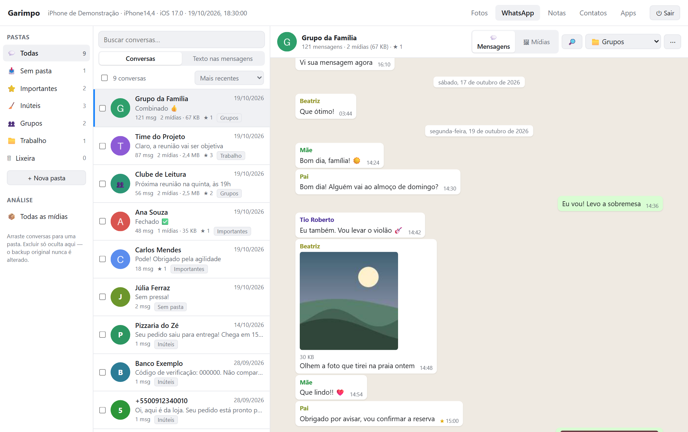
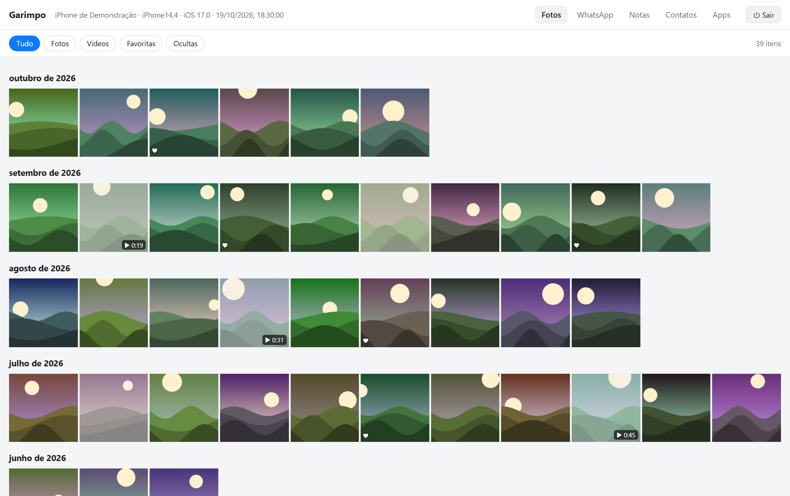
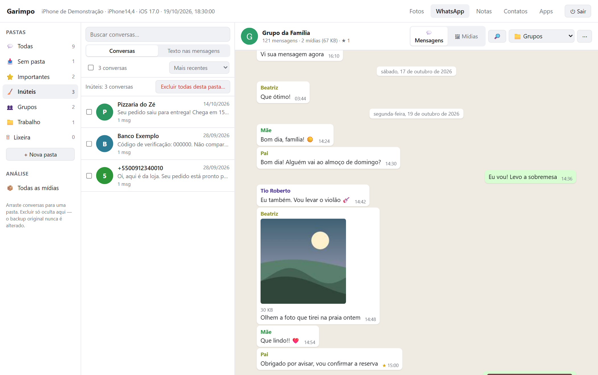
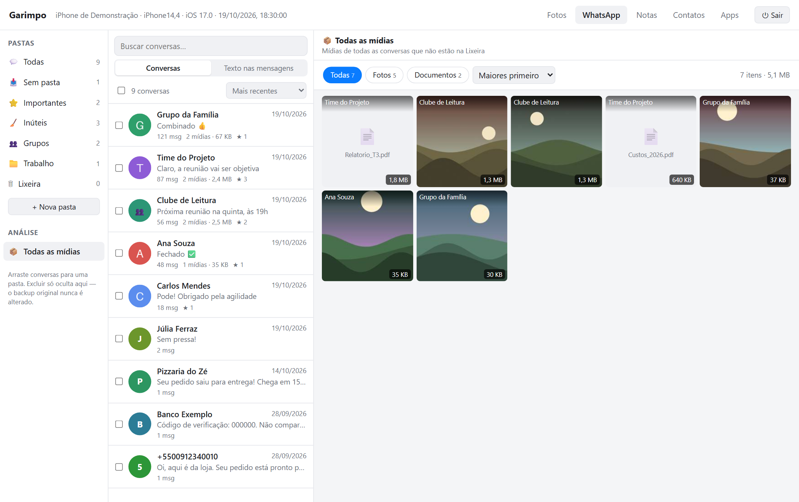
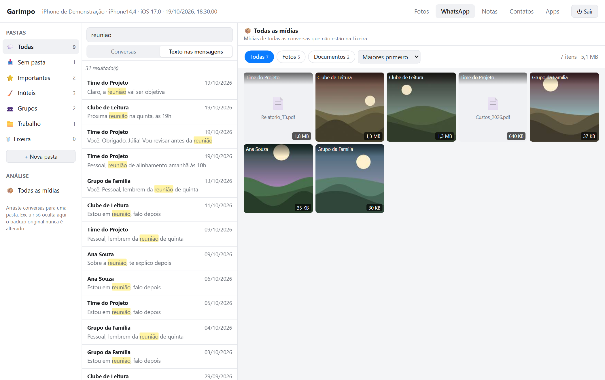
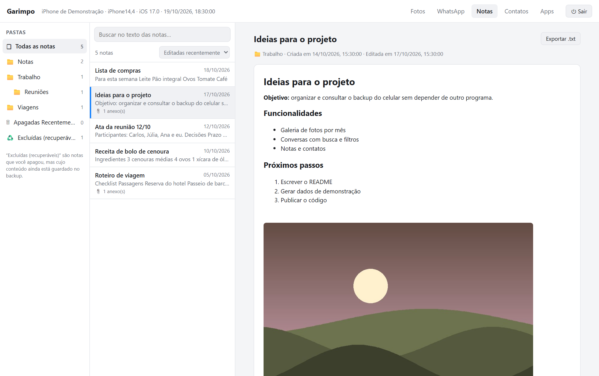
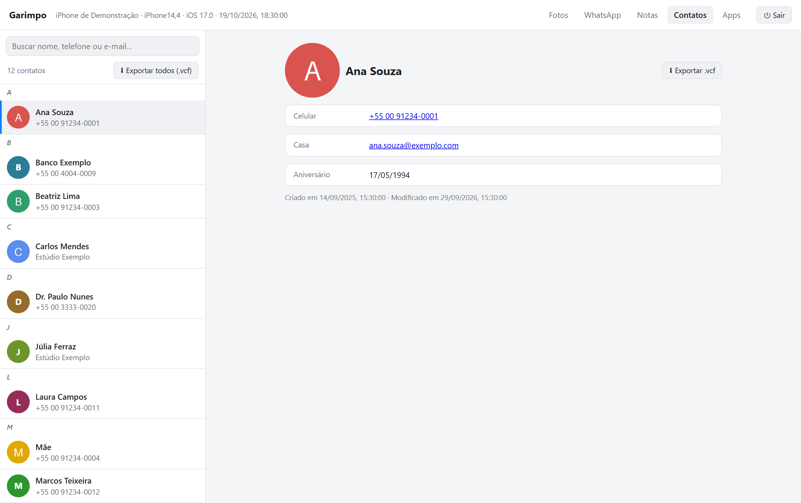
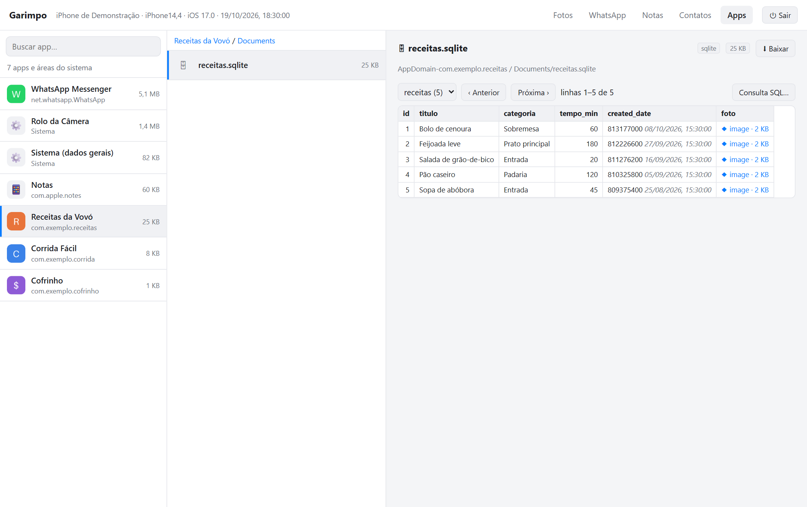
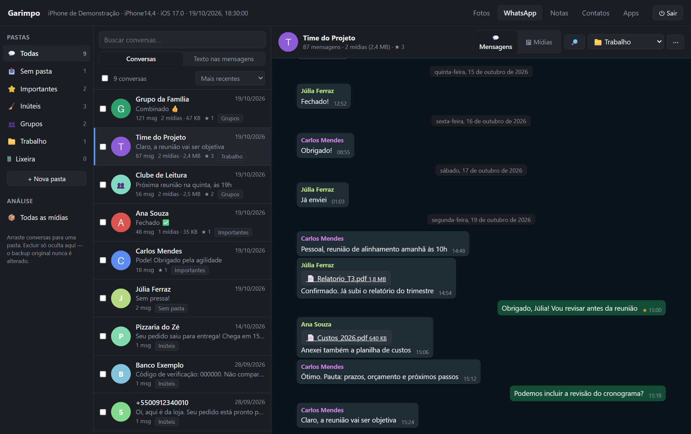

# Garimpo

**Explore, organize e recupere os dados do backup do seu iPhone, direto no computador.**

O Garimpo lê o backup que o iTunes / app *Dispositivos Apple* já salvou no seu PC e mostra suas **fotos, conversas do WhatsApp, notas, contatos** e os arquivos de **qualquer app** — tudo local, sem enviar nada para a internet e sem nunca alterar o backup original.



> Os prints deste projeto usam um **backup fictício** (nomes, mensagens e fotos inventados), gerado por [`tools/gerar_backup_demo.py`](tools/gerar_backup_demo.py).

## O que dá para fazer

### 📷 Fotos
Galeria agrupada por mês, com filtros (fotos, vídeos, favoritas, ocultas). Fotos **HEIC** abrem em alta resolução e podem ser baixadas como **JPG**. Dá para exportar tudo de uma vez pela linha de comando.



### 💬 WhatsApp e WhatsApp Business
- **Conversas** com foto de perfil, fotos, vídeos, áudios, figurinhas, documentos, contatos e localizações.
- **Busca no texto** de todas as mensagens (ou só da conversa aberta), ignorando acentos e maiúsculas — um clique leva até a mensagem.
- **Pastas**: *Sem pasta*, *Importantes*, *Inúteis* (conversas de uma só mensagem vão para lá automaticamente), *Grupos* e as que você criar. Arraste e solte, ou mova várias de uma vez.
- **Limpeza**: exclua mensagens e conversas (vão para a *Lixeira* e podem ser restauradas), mantendo as **mensagens favoritas** se quiser. Isso só **oculta no Garimpo** — o backup original não é tocado.
- **Mídias** de cada conversa, ou de todas juntas, com filtro por tipo e ordenação **por tamanho** para achar o que mais pesa.
- **Exportação**: uma conversa em `.txt`, ou tudo organizado em pastas (texto + mídias).





### 🗒 Notas
Pastas e subpastas, títulos, negrito, listas, checklists, imagens, galerias, desenhos e links. Mostra também as **notas apagadas que ainda estão no backup**.



### 👤 Contatos
Ficha completa (telefones, e-mails, endereços, aniversário, foto), busca por nome ou número e exportação em **vCard (.vcf)**, que outros aplicativos importam.



### 📱 Apps: explorador de qualquer app
Navegue pelos arquivos de qualquer app do backup. Bancos **SQLite** viram tabelas (com datas traduzidas e consulta SQL **somente leitura**), listas **plist** ficam legíveis (inclusive o formato `NSKeyedArchiver`), e imagens, vídeos, áudios, PDFs e textos abrem na hora.



Também há tema escuro automático:



## Como usar

### 1. Faça um backup **sem criptografia**
- **Windows**: instale o app *Dispositivos Apple* (Microsoft Store) ou o iTunes, conecte o iPhone e faça o backup em **"Este computador"**, deixando **"Criptografar backup local" desmarcado**.
- **macOS**: Finder → seu iPhone → *Fazer backup agora* (sem criptografar).

O Garimpo procura os backups nas pastas padrão:
`%USERPROFILE%\Apple\MobileSync\Backup`, `%APPDATA%\Apple Computer\MobileSync\Backup` (Windows) e `~/Library/Application Support/MobileSync/Backup` (macOS). Se estiverem em outro lugar, use `--backup-dir`.

### 2. Instale e rode
Precisa de **Python 3.9 ou mais novo** (os testes automáticos foram rodados no 3.13 e no 3.14). Não há dependências obrigatórias.

```bash
git clone https://github.com/joaoavelar/garimpo.git
cd garimpo
python -m pip install pillow pillow-heif    # opcional: fotos HEIC e ícone dos atalhos
python garimpo.py
```

No Windows, para ter um ícone na Área de Trabalho e no Menu Iniciar (abre numa janela própria, sem terminal, e fecha sozinho):

```bash
python garimpo.py --criar-atalhos
```

### Opções úteis
| Comando | O que faz |
|---|---|
| `python garimpo.py --backup-dir D:\Backups` | Procura os backups em outra pasta |
| `python garimpo.py --janela` | Janela própria (Edge/Chrome), sem console |
| `python garimpo.py --export-photos D:\Fotos --jpg` | Copia todas as fotos/vídeos, convertendo HEIC em JPG |
| `python garimpo.py --export-whatsapp D:\WhatsApp` | Exporta as conversas organizadas nas suas pastas, com as mídias |
| `python garimpo.py --dados PASTA` | Onde guardar suas pastas e exclusões |

Suas pastas, exclusões e favoritas ficam em `%APPDATA%\Garimpo` (Windows), `~/Library/Application Support/Garimpo` (macOS) ou `~/.local/share/Garimpo` (Linux) — **fora do projeto**, para nunca irem parar num commit.

## Privacidade e segurança
O backup de um celular tem coisas muito pessoais, então o Garimpo foi feito para ficar fechado em si mesmo:

- **100% local**: o servidor escuta só em `127.0.0.1`. Nada é enviado, não há telemetria, nenhuma fonte ou script externo.
- **Somente leitura**: os bancos do backup são abertos em modo *imutável*; testes automáticos confirmam que ler tudo **não cria nem altera nenhum arquivo** no backup. "Excluir" só oculta dentro do Garimpo.
- **Validação do cabeçalho `Host`** e checagem de `Origin`: um site aberto no navegador não consegue ler seus dados nem mexer no app (proteção contra *DNS rebinding* e CSRF).
- **Política de segurança de conteúdo (CSP)** restritiva e `nosniff`: a página só fala com o próprio servidor.
- **Arquivos do backup nunca viram página**: HTML, SVG e JavaScript de dentro do backup são servidos como download, nunca executados.
- **SQL somente leitura**: o explorador só aceita `SELECT`; `DROP`, `UPDATE`, `ATTACH`, `PRAGMA` etc. são bloqueados.
- Cópias temporárias de bancos (quando há um arquivo `-wal` pendente) ficam numa pasta temporária apagada ao sair (se o programa for encerrado à força, pode sobrar uma pasta `garimpo_*` no diretório temporário; é seguro apagá-la).

Ao compartilhar prints ou vídeos, lembre-se de que eles podem conter conversas e contatos de **outras pessoas**.

## Limitações
- **Backups criptografados não são suportados** (ainda). Nesses, a Apple também protege o histórico de chamadas, as senhas salvas e os dados de Saúde — por isso eles **não aparecem** em backups sem criptografia.
- O formato do banco do WhatsApp **não é documentado** e pode mudar numa atualização do app. O Garimpo foi desenvolvido e testado com um backup de iOS 16.6; outras versões podem ter diferenças.
- Mídias que o iPhone nunca baixou, fotos que ficaram só no iCloud e mídias de "visualização única" não existem no backup; o Garimpo avisa quando isso acontece.
- Notas: tabelas aparecem apenas como "📊 Tabela", e notas protegidas por senha não podem ser lidas.
- HEIC precisa de `pillow-heif`; vídeos HEVC podem não tocar em todos os navegadores (use "Baixar original").
- O alvo principal é o **Windows**. Em macOS e Linux o servidor deve funcionar com `--backup-dir`, mas não foi testado, e os atalhos (`--criar-atalhos`) são só para Windows.

## Como funciona
Veja [`docs/como-funciona.md`](docs/como-funciona.md): estrutura de um backup do iPhone, como cada tipo de dado é guardado e como o Garimpo o lê.

## Desenvolvimento
```bash
python tools/gerar_backup_demo.py demo                  # cria um backup fictício em demo/
python garimpo.py --backup-dir demo --dados demo/dados  # abre o Garimpo nele
python -m unittest discover -s tests                    # testes (usam o backup fictício)
python tools/capturar_telas.py                          # refaz os prints de docs/img
```
Os testes cobrem a leitura de cada tipo de dado, a garantia de não alterar o backup, a exclusão só visual e a segurança do servidor (Host, Origin, tipos de arquivo, SQL somente leitura, caminhos fora do backup).

## Aviso
O Garimpo é um projeto independente, **sem qualquer ligação com Apple, WhatsApp ou Meta**. *iPhone*, *iOS* e *iTunes* são marcas da Apple Inc.; *WhatsApp* é marca da Meta Platforms, Inc. Use somente com backups dos **seus próprios** aparelhos.

## Licença
[MIT](LICENSE)
